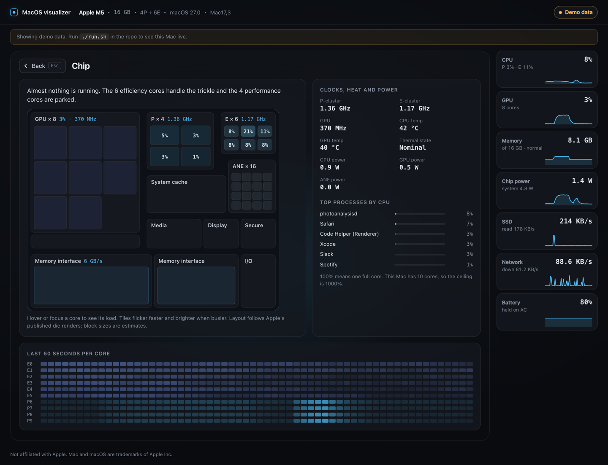
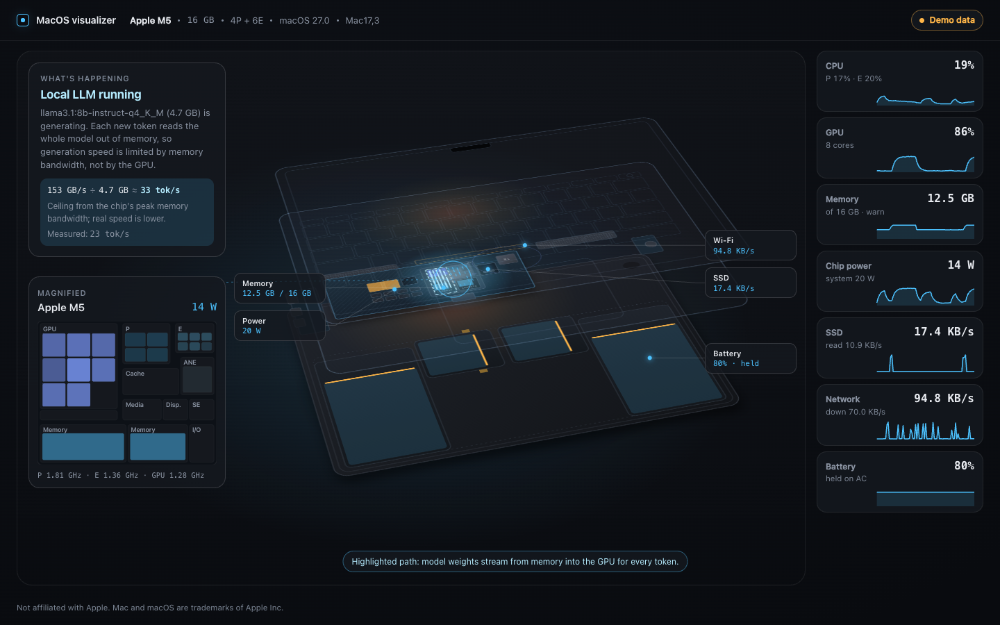

# MacOS visualizer

Your Mac, exploded into parts, with every part showing what it is doing right now.


*The animation is demo data during a local LLM run. The still is a real reading from an M5 MacBook Air.*

It's a free, open-source toy. A small Swift program reads the hardware counters on an Apple Silicon Mac (no sudo), and a web page draws an exploded MacBook where the cores flicker, memory traffic flows as particles and heat spreads through the case. A card in the corner tells you in plain words what the machine is busy with.

## Run it

You need:

- an Apple Silicon Mac (M1 or later)
- Xcode or the Command Line Tools, for `swift` (`xcode-select --install`)
- Node.js 20.19+ or 22.12+, to build the page once (Vite 8 needs one of those)

```bash
git clone https://github.com/<you>/macos-visualizer
cd macos-visualizer
./run.sh
```

`run.sh` builds the page if it's missing or stale, builds the reader in release mode, starts it and opens http://127.0.0.1:7878/. Ctrl-C stops it. `./run.sh --no-open` skips the browser, and `./run.sh --port 7979` picks another port. Unknown flags are refused rather than ignored.

No Mac handy, or just curious? Run `npm --prefix web install && npm --prefix web run dev` and open http://localhost:5173/?demo. Demo mode plays a synthetic M5 with 16 GB, including a local LLM run about once a minute. The page labels it "Demo data" so nobody mistakes it for the real thing.

## What you'll see

- A die map of the chip with the GPU and Neural Engine next to the CPU clusters, with clocks and watts where macOS exposes them.
- Unified memory as a block map split into wired, app, compressed, cached and free, with the biggest processes painted onto it. Swap and memory pressure sit beside it.
- Memory bandwidth as particles running between the DRAM and the chip. More GB/s, more particles.
- Battery cells that fill to the charge level, and whether it's charging, draining or held at a limit on AC.
- SSD reads and writes and Wi-Fi traffic as their own particle streams.
- Heat spreading out from the chip through the case. The Air has no fan, so the warmth goes into the aluminium and you can watch it happen.
- A "What's happening" card that names the current workload: idle, background indexing, a compile, GPU-heavy work, or a local LLM generating text.

Click any part to open its panel.



When Ollama or LM Studio is generating, the card explains why speed depends on memory bandwidth more than on the GPU, and works out the ceiling: your chip's peak bandwidth divided by the model's size. A model that is loaded but idle gets a one-line note instead.



## How it reads your Mac

The reader (`macviz`) is plain Swift with no third-party packages. It uses:

- `host_processor_info` for per-core load
- IOReport for clocks, power (the CLPC energy counters on macOS 27, the "Energy Model" channels on older macOS) and the memory controller's bandwidth histogram
- the SMC for temperatures, system power and fans
- `AppleSmartBattery` in IORegistry for the battery
- `host_statistics64` and `proc_pid_rusage` for memory and processes
- `IOBlockStorageDriver` statistics and `getifaddrs` for disk and network
- Ollama's `/api/ps` and LM Studio's model list on localhost for loaded models

None of this needs root. Anything it can't read on your machine comes through as `null` and the page shows "n/a", never a made-up 0. It costs about 1% of one core while a page is connected.

[docs/how-it-works.md](docs/how-it-works.md) explains every visual and where its number comes from. [reader/README.md](reader/README.md) has the full source table and the list of fields that can be null. [CONTRACT.md](CONTRACT.md) is the JSON shape between the two halves.

## Privacy

- The server binds to 127.0.0.1 only. Nothing on your network can reach it.
- Every HTTP request must carry a `Host` of `127.0.0.1:<port>` or `localhost:<port>`, or it gets a 403. That blocks DNS rebinding.
- A WebSocket with an `Origin` header is accepted only from the page itself (`http://127.0.0.1:<port>`, `http://localhost:<port>`) or the Vite dev server on port 5173. Any other website's tab gets a 403 and can't read your stats. A client that sends no `Origin`, like a Node script or curl on your own machine, is allowed.
- It holds at most 64 connections and drops any socket that hasn't sent a request within 10 seconds. Static files are served only from the web folder (`web/dist` by default), and a path or symlink that leads outside it gets a 403.
- Nothing is sent anywhere. No analytics, no telemetry, no update check. The only outbound requests are to Ollama and LM Studio on your own machine.
- The page can see what Activity Monitor shows a normal user: load, clocks, power, temperatures, memory, battery, disk and network byte counts, the names and memory of your top processes, and the names of loaded LLM models. It can't see file names, URLs, window titles or anything inside network traffic.

## What's tested and what isn't

Tested on one machine: a 13-inch M5 MacBook Air (Mac17,3) with 16 GB on macOS 27.

Everything else is less certain:

- On macOS 27 the CPU, GPU and Neural Engine power counters have chip-specific IDs. The table comes from macmon and covers M1 to M5, including Pro, Max and Ultra. Only the M5 row has been checked on real hardware. If your chip isn't in the table, CPU and ANE power show "n/a".
- Older macOS should fall back to the "Energy Model" channels, but nobody has run it there yet.
- The 3D scene is the 13-inch MacBook Air layout for every Mac. A MacBook Pro, a 15-inch Air or a Mac mini will show up drawn as a 13-inch Air with your chip's numbers.
- DRAM power reads 0 on macOS 27 and shows as "n/a". The Neural Engine core count isn't exposed anywhere, so the Neural Engine is drawn as one block rather than an invented number of cores.
- The LLM ceiling needs the chip's peak bandwidth, which comes from a table of Apple's published figures (M1 to M5). A chip missing from it gets the explanation and the model size, but no number.
- Token rate is not measured live. Neither Ollama nor LM Studio reports it without proxying requests, so live mode shows the ceiling only. The "Measured" line in the screenshot is demo data.

If you run it on another chip, an issue with the output of `swift run -c release --package-path reader macviz --selftest` would help a lot.

## Ideas and contributing

Things that would make it better, roughly in order:

- Per-model layouts: the 15-inch Air, and the MacBook Pro with its fans (the scene already draws as many fans as the reader reports, it just needs the right chassis).
- Desktop Macs: Mac mini, iMac, Mac Studio.
- Verifying the CLPC counter table on M1 to M4 and on Pro and Max chips.
- A menu bar mode, so it can live somewhere other than a browser tab.
- More workload stories: video calls, Xcode previews, Time Machine, a browser with 200 tabs.

The workspace has three parts: `reader/` (Swift), `web/` (React + Vite) and `docs/`. The reader and the page each have their own README. Web tests run with `npm --prefix web test` on Node's built-in runner (Node 22.18 or later, for built-in TypeScript stripping). Please keep it dependency-light. The reader has no third-party packages and the page has only React.

## Credits

- [macmon](https://github.com/vladkens/macmon) by vladkens (MIT) for the IOReport and CLPC counter IDs per chip. Without it the macOS 27 power numbers would be guesswork.
- iFixit's MacBook Air teardowns for where things sit inside the case. The layout was measured from their photos and described in [docs/teardown-reference.md](docs/teardown-reference.md). No images were copied.

## License

MIT. See [LICENSE](LICENSE).

Not affiliated with Apple. Mac, MacBook Air and macOS are trademarks of Apple Inc.
