# SiliconSight

See inside your Apple Silicon Mac while it works. Every core, the memory, the power draw, the SSD and the sensors show live on an exploded 3D laptop. Around it sit a free 16-lesson course, 12 animated labs on how computers work, and seven games played with the Mac's own sensors.

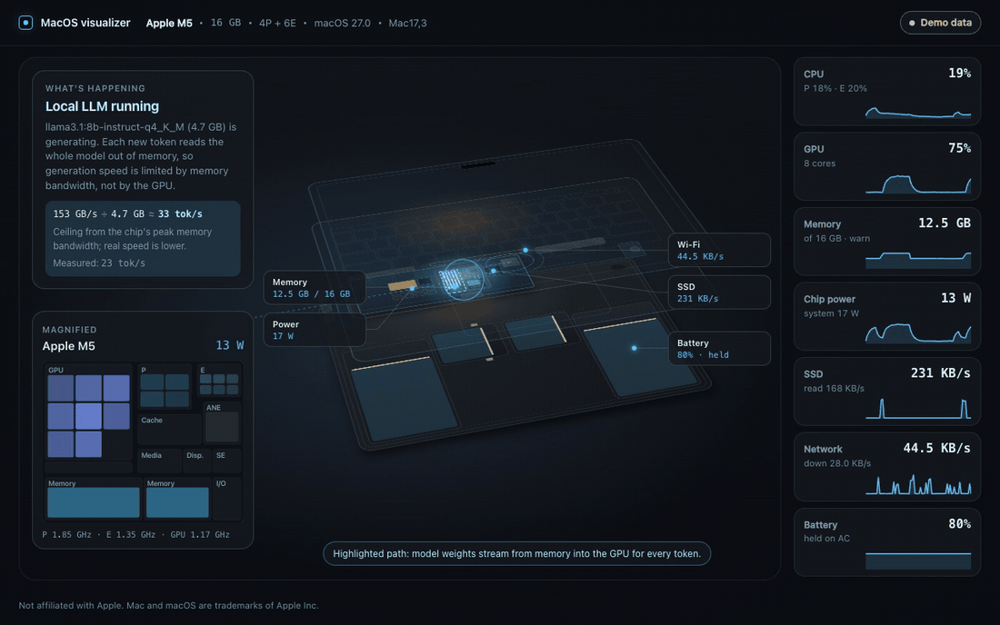

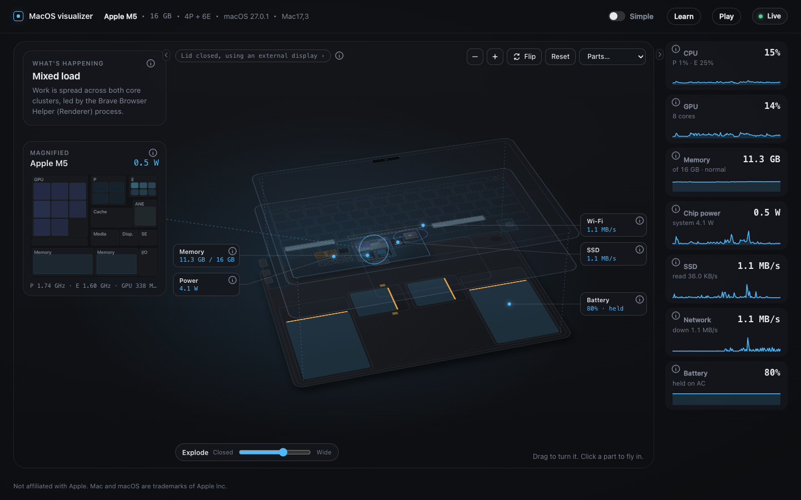

*The animation is demo data during a local LLM run and was recorded before the Learn, Labs and Play links existed. The still is a real reading from an M5 MacBook Air.*

A small Swift program reads the hardware counters, with no sudo, and a web page draws the laptop. The cores flicker with their real load, memory traffic flows as particles, and heat spreads through the case. A card in the corner says in plain words what the machine is busy with. Nothing leaves your Mac.

It's free and open source under the Apache 2.0 license. The course and the labs list every source they rely on, so you can check any claim. The full list is in [docs/learn/sources.md](docs/learn/sources.md).

## Run it

You need:

- an Apple Silicon Mac (M1 or later)
- Xcode or the Command Line Tools, for `swift` (`xcode-select --install`)
- Node.js 20.19+ or 22.12+, to build the page once (Vite 8 needs one of those)

```bash
git clone https://github.com/RAJAY04/siliconsight.git
cd siliconsight
./run.sh
```

`run.sh` builds the page if it's missing or stale, builds the reader in release mode, starts it and opens http://127.0.0.1:7878/. Ctrl-C stops it. `./run.sh --no-open` skips the browser, and `./run.sh --port 7979` picks another port. Unknown flags are refused rather than ignored.

### Demo mode

Add `?demo` to the address (http://127.0.0.1:7878/?demo) to play synthetic data instead of your Mac's. It's an M5 with 16 GB that runs a local LLM about once a minute, scrolls the trackpad, moves the lid, takes a video call every two minutes and plays music now and then. The page labels it "Demo data" so nobody mistakes it for a real reading. If the reader isn't running at all, the page switches to demo data on its own after 3 seconds and goes live when the reader appears.

No Mac handy? Run `npm --prefix web install && npm --prefix web run dev` and open http://localhost:5173/?demo.

## What's in it

### The exploded laptop

The scene is a 13-inch MacBook Air drawn in 3D: bottom case, logic board, top case and lid as separate layers. Drag to turn it, scroll or pinch to zoom, and use the Explode slider to pull the layers apart or close them up. Flip turns it over to the bottom case. On a phone, a sideways drag turns the laptop and an up or down swipe scrolls the page.

- A die map of the chip with the GPU and Neural Engine next to the CPU clusters, with clocks and watts where macOS exposes them.
- Memory bandwidth as particles running between the DRAM and the chip. More GB/s, more particles.
- SSD reads and writes and Wi-Fi traffic as their own particle streams.
- Battery cells that fill to the charge level, and whether it's charging, draining or held at a limit on AC.
- Heat spreading out from the chip through the case. The Air has no fan, so the warmth goes into the aluminium.
- The lid follows the real hinge angle, and fingers on the trackpad show up on the drawn trackpad.
- A "What's happening" card that names the current workload: idle, background indexing, a compile, GPU-heavy work, or a local LLM generating text.

When Ollama or LM Studio is generating, the card explains why speed depends on memory bandwidth more than on the GPU, and works out the ceiling: your chip's peak bandwidth divided by the model's size.

### Close-ups and docked panels

Click a part, or pick one from the Parts menu, and the camera flies in. Show more opens the part's panel docked beside the close-up, so the part keeps moving while you read its numbers. The side columns resize by dragging their edges and fold away with the arrow buttons; the page remembers the widths. On a phone the panel opens as a drawer from the bottom edge.

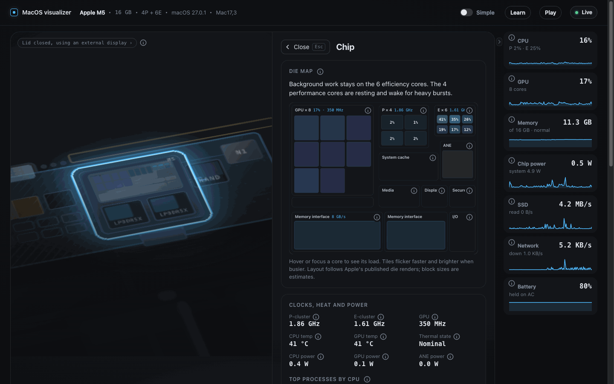

The panels cover the chip, memory, battery, storage and network, power, and sensors. The memory panel paints the biggest processes onto a block map of RAM and shows swap and pressure beside it.

### Inside: sensors and media

The sensors panel has a sensor map: the laptop with its lid at the live angle and a numbered marker on the camera, ambient light sensor, microphones, speakers, hinge sensor, keyboard, trackpad and display. The camera, microphones and speakers animate while they're in use. Signal paths show the steps between an app and the hardware, for example app, Core Audio, DAC and amp, speakers. The chip panel has a media engine card with decode and encode lanes that move only while the hardware video engines are busy.

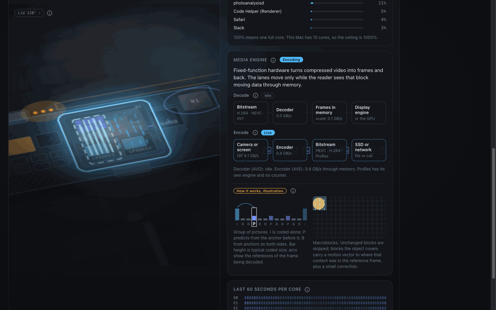

### Simple Mode

The Simple switch in the header swaps the technical names for everyday ones across the whole page: Fast Workers and Eco Workers for the CPU cores, Desk Space for memory, Highway Speed for memory bandwidth, Overflow Storage for swap. The course and the explainers use the same names.

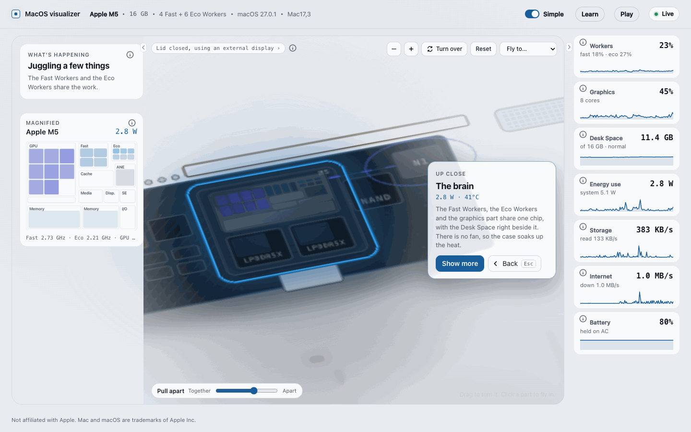

### Explainers

Every small "i" button opens a short explainer about that number or part, in plain words or in technical detail. Explainers link to each other and to the lesson that covers them.

### The course

Learn opens a self-paced course of 16 lessons, from orientation and CPU cores through memory, local LLMs, storage, battery and sensors to a capstone. Each lesson has an "In plain words" part and a technical part, points at something you can watch in the app, and ends with an experiment to run in Terminal. Lessons live at `#learn/01` to `#learn/16`, and the source text is in [docs/learn](docs/learn).

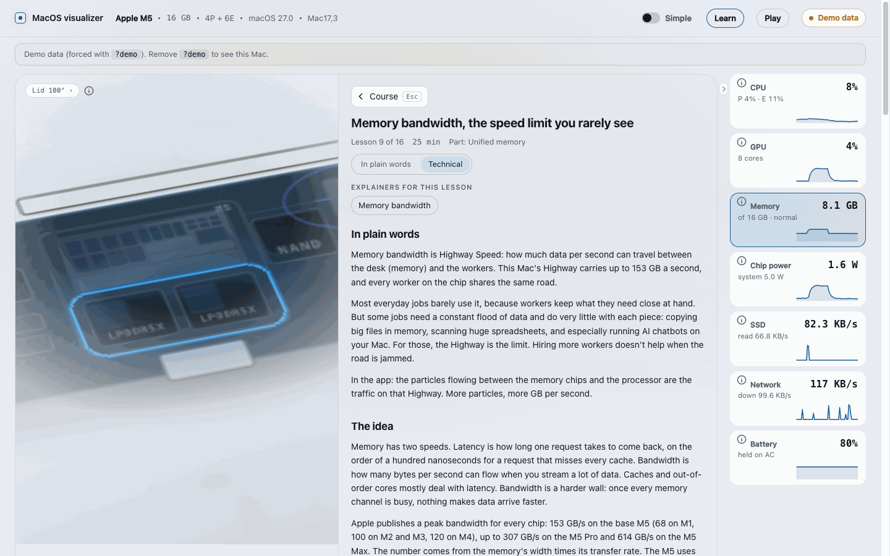

### Labs

Labs (`#labs`) holds 12 animated explainers of computer science fundamentals, each told on this Mac. Every lab has a step-through story with Play all, Replay and arrow keys, a "Try it" card where you change something and see the result, a reading card for going deeper, and the sources its facts come from. Where a lab is marked live, it shows this Mac's own counters beside the animation.

- Memory: virtual memory (page tables, the TLB, page faults, shared pages, copy on write), compression and swap, unified memory against a PC with a graphics card, and caches with a small cache simulator.
- Processor: inside a CPU core (pipeline, out-of-order execution, branch prediction, with a guess-the-branch game), threads and the scheduler with a simulator on this Mac's cores, Core X-ray (every core live: load, clock, idle states, interrupts and the busiest threads), and how a GPU thinks.
- Apps and storage: what happens when you open an app, from the Dock click to the first frame, and how an SSD stores data.
- Talking to the world: a web page, packet by packet, from DNS to the Wi-Fi radio.
- Foundations: bits, bytes and text, from transistors to UTF-8.

Each lesson in the course links to the labs that go with it.

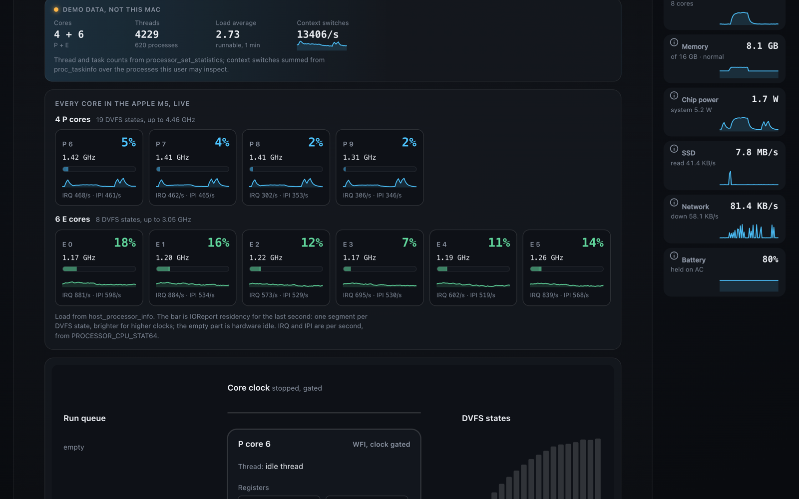

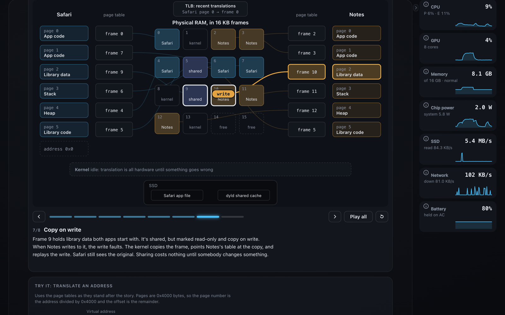

### Games

Play has seven games that use real sensors and counters, so winning one also proves the sensor and the reader work.

- Lid Challenge: tilt the lid to the target angle and hold it there. Five rounds, faster holds score more.
- Trackpad Drawing: trace a circle, square, star, M or spiral with one finger on the trackpad, and get a score for how close you came.
- Whack-a-Mole: tap the moles on the real trackpad as they pop up, then see your reaction time and how the trackpad finds a finger.
- Fill the RAM: open apps and tabs to push memory pressure up and reach four goals, while the page shows compression and swap step in. The page itself allocates nothing.
- Guess the Watts: guess how much power an action draws, then measure it for 10 seconds.
- Heat Race: put load on the CPU for up to 60 seconds and predict how far the clock drops, or how fast the fans spin on a Mac that has them.
- Wi-Fi Hot and Cold: walk around with the laptop to find the strongest signal.

In demo mode every game runs on simulated input, for example a slider for the hinge, clicks for the moles and a draggable floor plan for Wi-Fi.

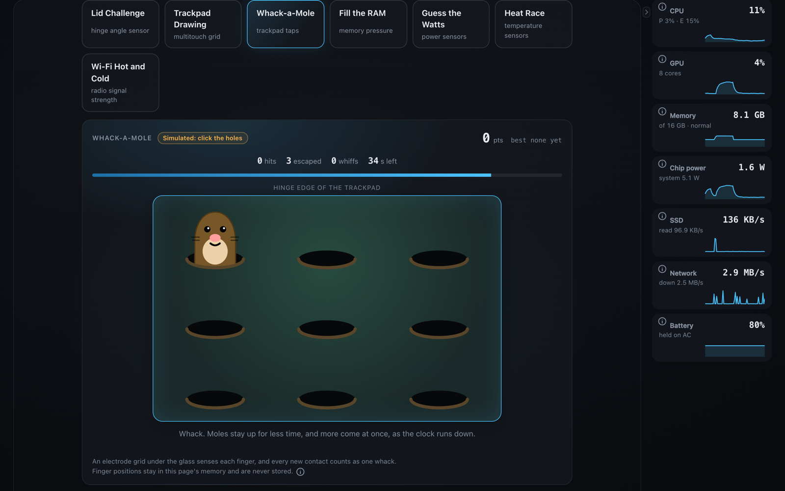

### Phones

The page works at phone width. The header fits in two rows, panels open as drawers from the bottom edge, and a vertical swipe on the laptop scrolls the page.

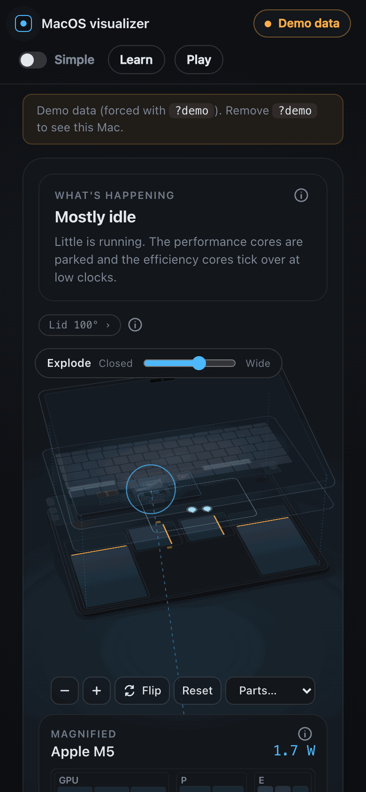

## System architecture

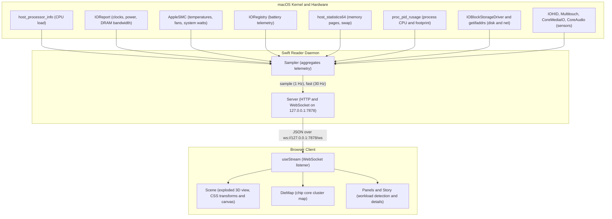

## How it reads your Mac

The reader (`macviz`) is plain Swift with no third-party packages. It uses:

- `host_processor_info` for per-core load
- IOReport for clocks, power (the CLPC energy counters on macOS 27, the "Energy Model" channels on older macOS) and the memory controller's bandwidth histogram
- the SMC for temperatures, system power and fans
- `AppleSmartBattery` in IORegistry for the battery
- `host_statistics64` and `proc_pid_rusage` for memory and processes
- `IOBlockStorageDriver` statistics and `getifaddrs` for disk and network
- Ollama's `/api/ps` and LM Studio's model list on localhost for loaded models
- `IOHIDDevice` for physical lid hinge angle and `MultitouchSupport` for trackpad touch contacts
- `PROCESSOR_CPU_STAT64`, `processor_set_statistics` and `proc_pidinfo` for per-core interrupts, thread counts and the busiest threads
- CoreWLAN for Wi-Fi signal strength, noise, rate and channel

None of this needs root. Anything it can't read on your machine comes through as `null` and the page shows "n/a", never a made-up 0. It costs about 2% of one core.

[docs/how-it-works.md](docs/how-it-works.md) explains every visual and where its number comes from. [reader/README.md](reader/README.md) has the full source table and the list of fields that can be null. [CONTRACT.md](CONTRACT.md) is the JSON shape between the two halves.

## Privacy

Everything runs on your Mac. The reader serves the page and the data on 127.0.0.1 and nothing leaves the machine.

- The server binds to 127.0.0.1 only. Nothing on your network can reach it.
- Every HTTP request must carry a `Host` of `127.0.0.1:<port>` or `localhost:<port>`, or it gets a 403. That blocks DNS rebinding.
- A WebSocket with an `Origin` header is accepted only from the page itself (`http://127.0.0.1:<port>`, `http://localhost:<port>`) or the Vite dev server on port 5173. Any other website's tab gets a 403 and can't read your stats. A client that sends no `Origin`, like a Node script or curl on your own machine, is allowed.
- It holds at most 64 connections and drops any socket that hasn't sent a request within 10 seconds. Static files are served only from the web folder (`web/dist` by default), and a path or symlink that leads outside it gets a 403.
- Nothing is sent anywhere. No analytics, no telemetry, no update check. The only outbound requests are to Ollama and LM Studio on your own machine.
- The page can see what Activity Monitor shows a normal user: load, clocks, power, temperatures, memory, battery, disk and network byte counts, the names and memory of your top processes, the names and priorities of the busiest threads, Wi-Fi signal strength, noise, rate and channel, and the names of loaded LLM models. It never reads the Wi-Fi network name, which would need location permission. It can't see file names, URLs, window titles or anything inside network traffic.
- No keystrokes. The keyboard is read only for its backlight level. The trackpad sends finger positions while you touch it, for the drawn trackpad and the trackpad games, and nothing is recorded.
- For the camera and microphone the reader asks only whether some app has the device running. It never opens either one, so it gets no picture and no sound.

## What's tested and what isn't

Tested on one machine: a 13-inch M5 MacBook Air (Mac17,3) with 16 GB on macOS 27.

Everything else is less certain:

- On macOS 27 the CPU, GPU and Neural Engine power counters have chip-specific IDs. The table comes from macmon and covers M1 to M5, including Pro, Max and Ultra. Only the M5 row has been checked on real hardware. If your chip isn't in the table, CPU and ANE power show "n/a".
- Older macOS should fall back to the "Energy Model" channels, but nobody has run it there yet.
- The 3D scene is the 13-inch MacBook Air layout for every Mac. A MacBook Pro, a 15-inch Air or a Mac mini will show up drawn as a 13-inch Air with your chip's numbers.
- DRAM power reads 0 on macOS 27 and shows as "n/a". The Neural Engine core count isn't exposed anywhere, so the Neural Engine is drawn as one block rather than an invented number of cores.
- The LLM ceiling needs the chip's peak bandwidth, which comes from a table of Apple's published figures (M1 to M5). A chip missing from it gets the explanation and the model size, but no number.
- Token rate is not measured live. Neither Ollama nor LM Studio reports it without proxying requests, so live mode shows the ceiling only. The "Measured" line in the screenshot is demo data.

If you run it on another chip, an issue with the output of `swift run -c release --package-path reader macviz --selftest` would help a lot.

## Ideas and contributing

Things that would make it better, roughly in order:

- Per-model layouts: the 15-inch Air, and the MacBook Pro with its fans (the scene already draws as many fans as the reader reports, it just needs the right chassis).
- Desktop Macs: Mac mini, iMac, Mac Studio.
- Verifying the CLPC counter table on M1 to M4 and on Pro and Max chips.
- Checking Core X-ray on Pro and Max chips, which have more than one performance cluster. The per-core mapping was written on a chip with one.
- A menu bar mode, so it can live somewhere other than a browser tab.
- More workload stories: video calls, Xcode previews, Time Machine, a browser with 200 tabs.

The workspace has three parts: `reader/` (Swift), `web/` (React + Vite) and `docs/`. The reader and the page each have their own README. Web tests run with `npm --prefix web test` on Node's built-in runner (Node 22.18 or later, for built-in TypeScript stripping). Please keep it dependency-light. The reader has no third-party packages and the page has only React.

## Credits

- [macmon](https://github.com/vladkens/macmon) by vladkens (MIT) for the IOReport and CLPC counter IDs per chip. Without it the macOS 27 power numbers would be guesswork.
- The course and the explainers cite their sources in [docs/learn/sources.md](docs/learn/sources.md): Apple's documentation and newsroom, articles, papers and teardowns, with the lessons that use each one.
- iFixit's MacBook Air teardowns for where things sit inside the case. The layout was measured from their photos and described in [docs/teardown-reference.md](docs/teardown-reference.md). No images were copied.

## License

Apache License 2.0. See [LICENSE](LICENSE) and [NOTICE](NOTICE).

Not affiliated with Apple. Mac, MacBook Air and macOS are trademarks of Apple Inc.
